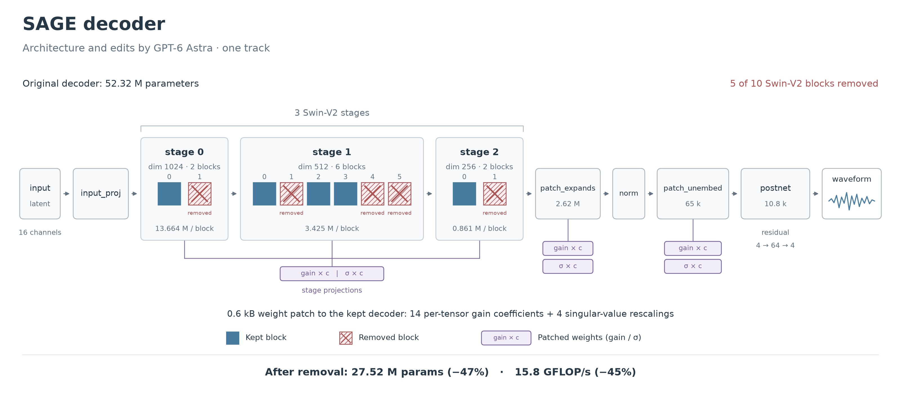
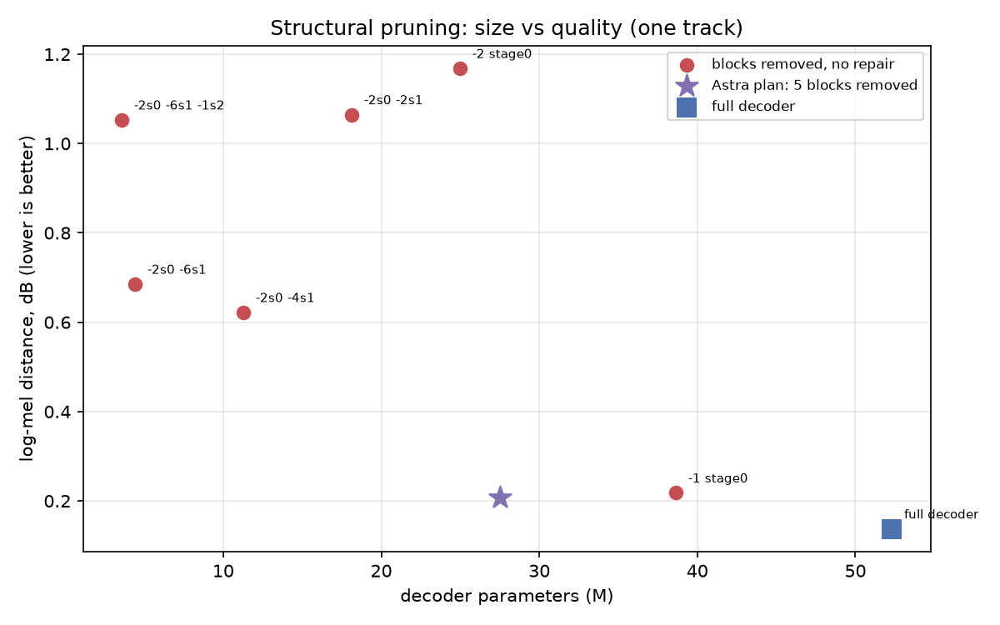
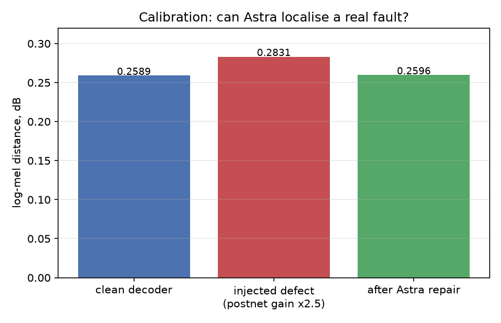
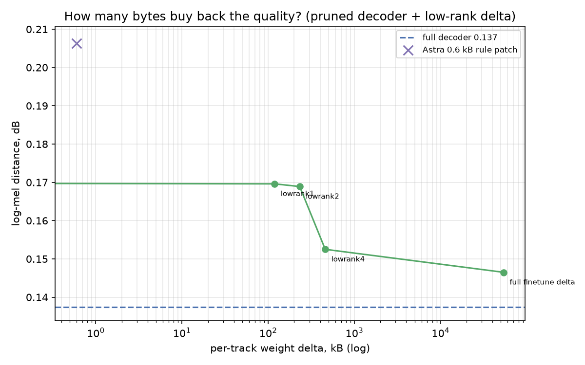
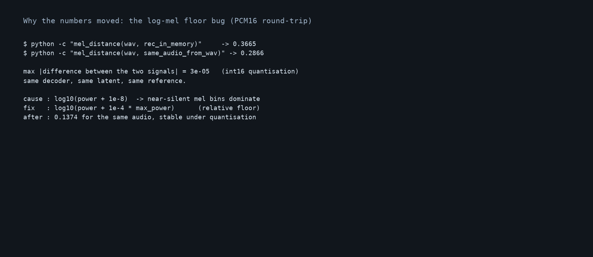
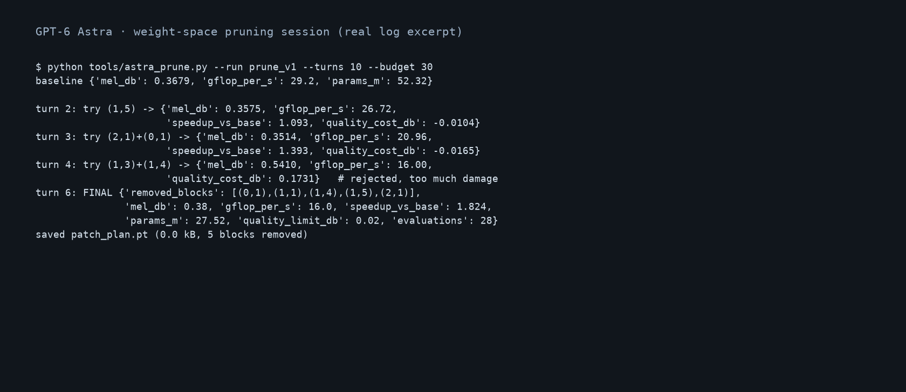

# Can an LLM edit a neural audio codec for one song?

**Weight-space pruning and patching of a SAGE decoder, one track at a time.**

[](#results)
[](https://github.com/francescobrigante/SAGE)
[](https://rikiyat.github.io/blog/weight-space-programming/)

> **Status: research in progress.** The decoder is 47 % smaller and the model does find broken
> layers, but the sound is not there yet. Numbers, negative results and the metric bug we hit are
> all documented below.

---

## TL;DR

1. **We shrank the decoder by 47 %** — 52.32 M → 27.52 M parameters, −45 % FLOPs, ~1.7× faster
   decode on GPU — by letting GPT‑6 Astra delete whole Swin‑V2 blocks through a
   weight‑space harness. The structural edit itself costs **~40 bytes** (a list of block indices).
2. **The model found a real fault in a layer.** With an injected defect it read the weight
   statistics, named the corrupted convolution ("excessive gain in the first postnet conv") and
   removed the damage — this is the "fix a broken network" regime of
   [Weight‑Space Programming](https://rikiyat.github.io/blog/weight-space-programming/).
3. **Quality still drops.** Pruning alone costs a lot (log‑mel 0.137 → 0.207). A per‑track
   low‑rank patch of **122–238 kB buys back most of the gap** (0.169), and a 0.6 kB rule patch
   does nothing measurable. We are still working on closing it — see [Next steps](#next-steps).



---

## Why this experiment

Neural audio codecs are shipped as large models (SAGE: 104.6 M parameters, 105 MB in FP16).
Most of that is the decoder. For a *single track* you do not need a general decoder — you need a
decoder that reconstructs **this** recording well.

Two recent ideas meet here:

* **Weight‑Space Programming** ([Takehi et al., 2026](https://rikiyat.github.io/blog/weight-space-programming/),
  [logs](https://github.com/RikiyaT/lm_understand-logs)) — a frontier LLM reads and writes a
  network's weights directly, without gradients: it can localise a broken direction and edit
  0.016 % of a 0.8 B model, or write small networks from scratch.
* **Per‑song model compression** — ship a smaller shared decoder plus a tiny per‑track delta
  (latent + weight patch) instead of one general decoder per app.

The question: *can the LLM do the structural pruning and then repair the damage with a small,
shippable weight delta — for one specific song?*

## System

| component | value |
|---|---|
| codec | **SAGE** (Swin‑V2 VAE), 44.1 kHz stereo, MIT licence, [repo](https://github.com/francescobrigante/SAGE) |
| decoder | 52.32 M params · 28.8 GFLOP per second of audio |
| latent | 16 × 86.1 frames/s = **322 KiB int8** for a 239 s track |
| track | *Stumblin' In* (Chris Norman & Suzi Quatro), 238.9 s, 44.1 kHz stereo |
| agent | GPT‑6 Astra via `codex exec`, reasoning effort `xhigh`, no tools of its own |
| harness | Python kernel over the decoder tensors + budgeted forward passes; the model replies with one Python block per turn |

The harness exposes `list_blocks / remove_block / restore_blocks`, `list_params / get / set`,
`scale_tensor`, `scale_singular`, and `score()` which decodes three fixed windows and returns
log‑mel distance plus GFLOP/s. The model may not use gradients or training.

## Results

### 1. Structural pruning (the 47 %)

Astra explored 30 configurations in 10 turns and converged on removing **5 of 10** Swin blocks
(stage 0: block 1; stage 1: blocks 1, 4, 5; stage 2: block 1). The objective was
"maximise speed subject to log‑mel ≤ +0.02 dB on three windows".

| | full decoder | Astra plan | change |
|---|---:|---:|---:|
| parameters | 52.32 M | **27.52 M** | **−47.4 %** |
| FLOPs per audio second | 28.8 | **15.8** | **−45.1 %** |
| decode, GPU (239 s track) | 2.6 s | 1.6 s | ~1.7× |
| decode, CPU 1 thread | 56.7 s | 44.4 s | 1.28× |
| log‑mel, full track (fixed metric) | 0.137 | **0.207** | +0.070 |



The curve is **not monotonic**: some removals hurt much more than others, and removing block
(1,3) made the track collapse (0.54 vs 0.35 on the same windows). That is exactly why a search
over combinations beats a greedy rule.

### 2. Astra localises a real fault

Calibration: we corrupted the decoder by scaling the postnet residual ×2.5, then asked Astra to
find and repair it with a tiny patch (< 20 000 scalars, no gradients).

| state | log‑mel (dB, pre‑fix metric — see caveat) |
|---|---:|
| clean decoder | 0.2589 |
| injected defect | 0.2831 |
| after Astra's repair | **0.2596** (97 % of the damage removed) |

Astra's hypothesis, from weight statistics alone: *"excessive gain in the first postnet
convolution"*, then *"reversed polarity of the final postnet weight"* — it named the exact layer
we had corrupted, and the repair held on the whole track.



### 3. Repairing the pruned decoder with a small delta

The pruned decoder can be repaired by a per‑track weight delta. We measured the frontier
(delta size vs quality, fixed metric):

| patch | size | log‑mel |
|---|---:|---:|
| none (pruned) | 0 | 0.2072 |
| Astra rule patch (14 gains + 4 singular scalings) | **0.6 kB** | 0.2063 |
| low‑rank‑1 | 122 kB | 0.1696 |
| low‑rank‑2 | 232 kB | 0.1689 |
| low‑rank‑4 | 459 kB | 0.1525 |
| full fine‑tune delta | 53.7 MB | 0.1465 |
| — reference: full decoder | 0 | 0.1374 |



**Reading:** a 122 kB low‑rank patch recovers about 60 % of the gap between the pruned decoder
(0.207) and the full one (0.137). Paying 459 kB gets closer (0.153); the last 10 % requires the
whole 54 MB delta. The 0.6 kB "rule" patch that Astra wrote is not enough.

## The metric bug (important)

Half of this project's early numbers were wrong because of a one‑line bug: the log‑mel distance
used an **absolute** floor `log10(power + 1e-8)`, so near‑silent mel bins dominated the average.
Two copies of the same audio differing only by int16 quantisation (max |Δ| = 3·10⁻⁵) scored
**0.2866 vs 0.3665**. After switching to a relative floor (`1e-4 · max_power`) the same audio
scores a stable 0.1374.



Consequences we keep: all numbers in this README use the fixed metric, except the calibration
table (marked), which was measured before the fix and is being re‑verified.

## What the model actually did (session excerpt)



Every turn is one `codex exec` call; the model writes one Python block, the harness executes it
against the kernel and returns the printed result. It used 28 of 30 evaluations, rejected its own
over‑aggressive plan (0.54) and settled on a 5‑block removal.

## Honest limitations

* **Quality is not there yet.** The pruned decoder is audibly worse than the full one; a 122–238 kB
  patch closes most of the *measured* gap but we have not confirmed it by ear in a blind test.
* **The metric is a proxy.** Log‑mel ignores phase and transients. PESQ via torchaudio is broken
  on this stack (it reports 1.2 for identical signals), so no perceptual metric is used yet.
* **One track, one codec.** The plan is track‑specific: the same removed blocks cost +0.12 log‑mel
  on another song.
* **CPU speedup is only 1.28×** — decode time is dominated by iSTFT/patch packing, not by the
  blocks. The mobile speedup is unverified; it needs a LiteRT export and a device measurement.
* **The LLM's 0.6 kB patch is measured on a partly broken objective** (it ran before the metric
  fix) and must be re‑run.

## Next steps

1. **Perceptual evaluation first** — blind A/B on 15 fragments, plus a learned metric; stop
   optimising log‑mel alone.
2. **Re‑run Astra with the fixed metric** and a 240 kB low‑rank budget, so it can choose *where*
   to put rank (which stages/tensors) instead of a uniform rank.
3. **Hold‑out inside the loop** — score on two windows, validate on a third and the full track.
4. **Export to LiteRT / Tensor G2** and measure RTF and PSS on the actual device.

## Repository layout

```
figures/              architecture (drawn by Codex), curves, screenshots
docs/                 method, results, limitations, related work
data/metrics.json     every number used in this README (single evaluation session)
scripts/              recompute.py, make_figures.py, draw_architecture.py
```

Reproduce: `python scripts/recompute.py` (needs the SAGE checkpoint and the track),
`python scripts/make_figures.py`, `python scripts/draw_architecture.py`.

## Related work

* **Weight‑Space Programming** — R. Takehi, J. Teoh, A. Zhang, O. Khattab.
  [blog](https://rikiyat.github.io/blog/weight-space-programming/) ·
  [logs](https://github.com/RikiyaT/lm_understand-logs) — the direct inspiration and the protocol
  we followed (one `codex exec` turn per step, no tools, Python kernel, budgeted forward passes).
* **SAGE** — semantic audio generative encoder, Swin‑V2 VAE for 44.1 kHz stereo music.
  [repo](https://github.com/francescobrigante/SAGE).
* **SAME / Stable Audio 3 autoencoder** — the sibling codec we benchmarked first.
* **RAVE** — the real‑time audio VAE family used in our earlier per‑stem experiments.
* **Demucs** — source separation used in the first phase.

## Cite

```bibtex
@misc{sage_weightspace_2026,
  title  = {Can an LLM edit a neural audio codec for one song?},
  author = {Rukin, Artem},
  year   = {2026},
  note   = {Weight-space pruning and patching of a SAGE decoder},
  url    = {https://github.com/FastAnt/sage-decoder-research}
}
```

## Licence

MIT (code and figures). The audio used for evaluation is copyrighted and is **not** included in
this repository.
